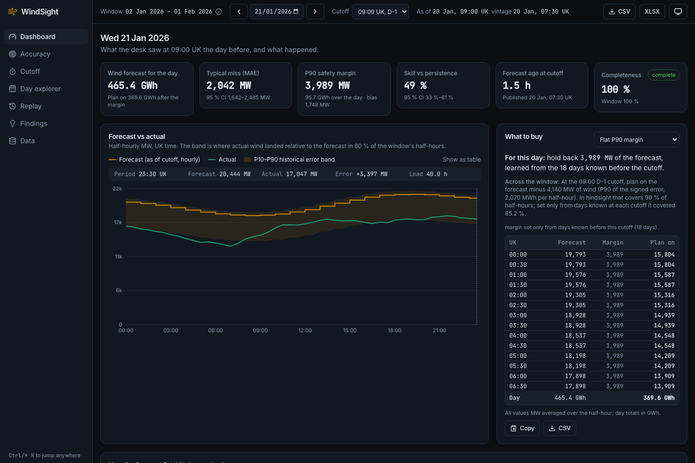
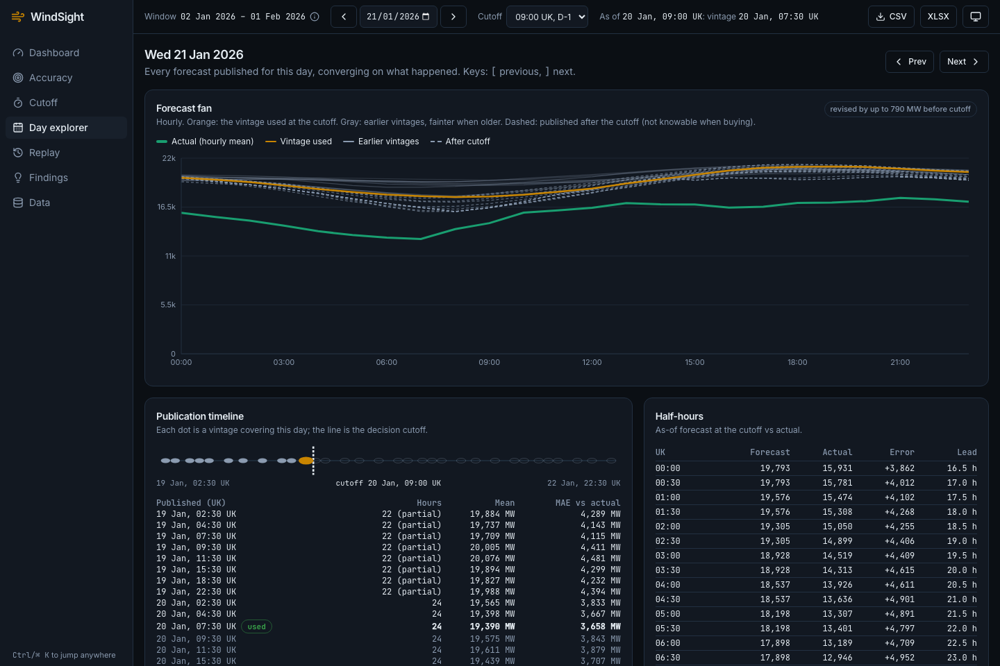
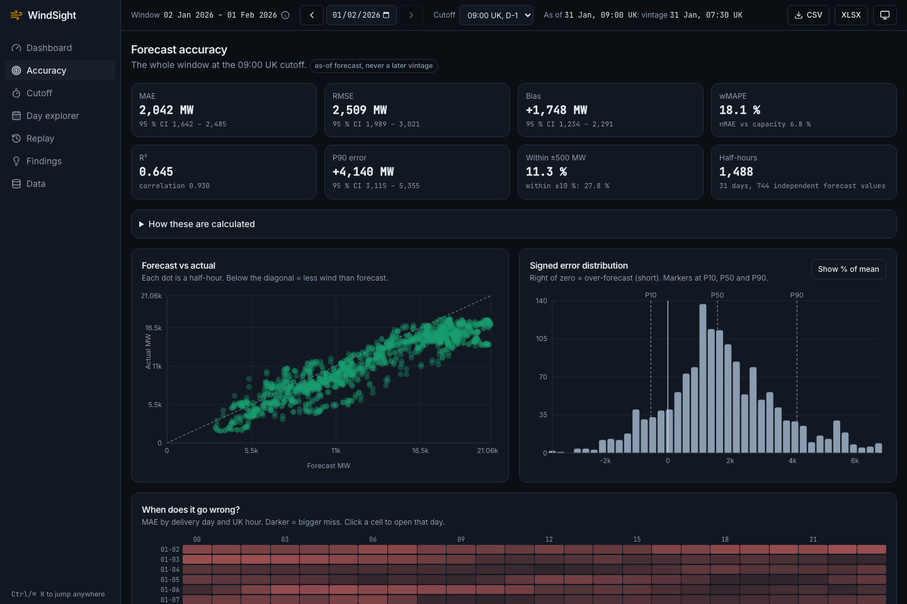
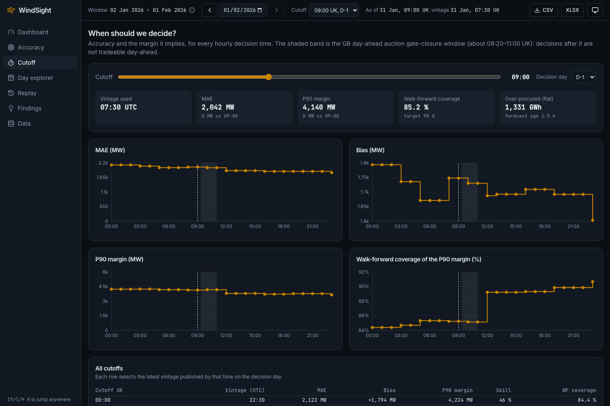
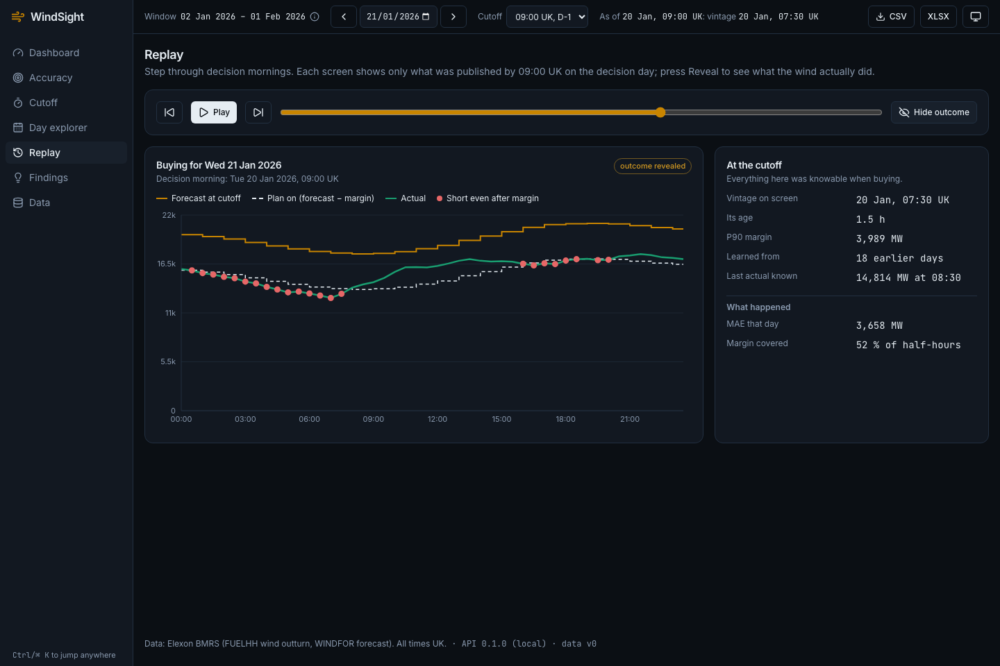
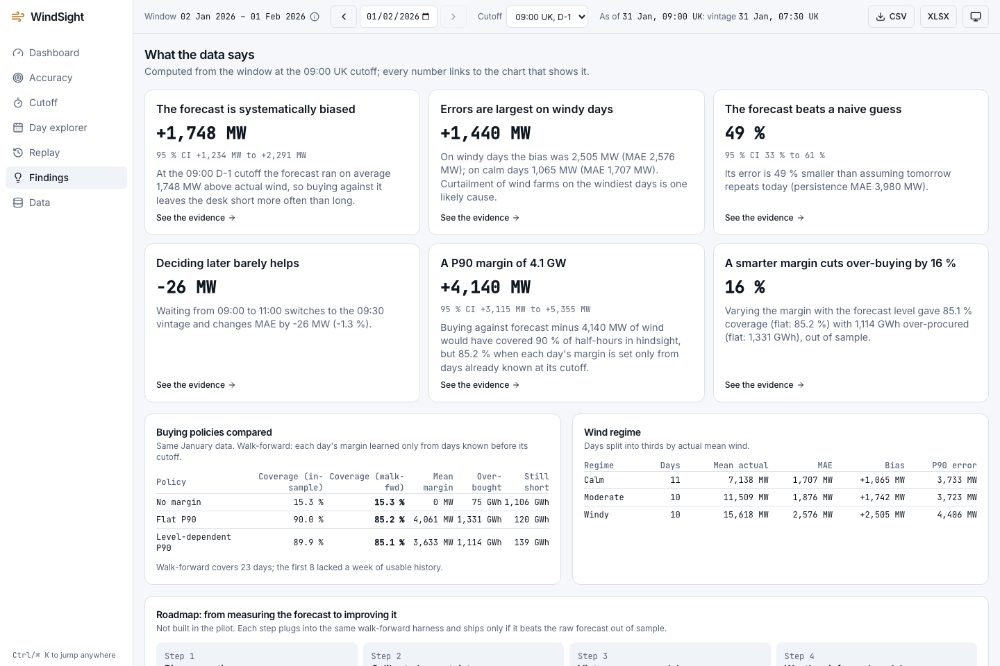
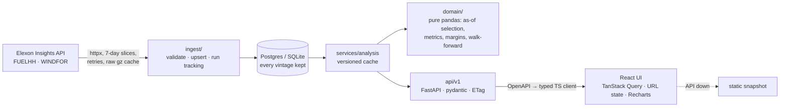

# WindSight

Decision support for a GB day-ahead power procurement desk. It shows the national wind forecast that was available **at the moment the desk had to buy**, measures how wrong that forecast has historically been, and turns the error into a procurement margin the desk can act on. Data: the Elexon BMRS Insights API (FUELHH wind outturn, WINDFOR forecasts), January 2026.

**The headline (09:00 UK cutoff on D-1, delivery 2 Jan – 1 Feb 2026):** the forecast the desk saw missed by **2,042 MW** on average (95 % CI 1,642–2,485) and ran **1,748 MW high** (1,234–2,291), so a desk buying against it is short in 85 % of half-hours. It still halves the error of a naive "same as yesterday" guess. A P90 margin of **4,140 MW** covers 90 % of half-hours in hindsight but **85 %** when each day's margin is learned only from earlier days. A margin that varies with the forecast level gives that same coverage with **16 % less over-buying**. Waiting from 09:00 to 11:00 improves accuracy by only 26 MW.

> **Live app: https://lmao-eta-cyan.vercel.app** (UI + API on Vercel; interactive API docs at [/docs](https://lmao-eta-cyan.vercel.app/docs)). Every number above is reproducible with `make report` and documented in [docs/METHODOLOGY.md](docs/METHODOLOGY.md).

| | |
|---|---|
|  |  |
|  |  |
|  |  |

| Page | What it answers |
|---|---|
| **Dashboard** `/` | For one delivery day: the forecast the desk saw at the cutoff, the actual, the error band, KPIs, and what to buy per half-hour |
| **Accuracy** `/accuracy` | How good is the forecast? Metrics with intervals, scatter, error histogram, day × hour heatmap, daily bias, lead time, band calibration |
| **Cutoff** `/cutoff` | When should we decide? Slider over every hourly cutoff, with the auction gate-closure window marked |
| **Day explorer** `/days/:date` | How did the forecast for one day evolve? Vintage fan, publication timeline, half-hour table (`[` / `]` to step) |
| **Replay** `/replay` | A time machine: only what was known each morning, then Reveal (Play auto-advances) |
| **Findings** `/findings` | Computed insights, policy comparison, wind regimes, AI/ML roadmap |
| **Data** `/data` | Coverage, data quality, ingest runs, live "Refresh from Elexon", sources and glossary |

Every view is a shareable link (e.g. `/?day=2026-01-15&cutoff=11:00&policy=conditional`). Press **Ctrl/⌘ K** to jump to a page, a day ("15 Jan") or a cutoff. All times are UK time, whatever the browser's timezone.

## Quick start

### Docker (one command)

```bash
docker compose up --build
```

Then open http://localhost:3000; the API is on http://localhost:8010/docs (`WEB_PORT` / `API_PORT` change the ports). Compose runs Postgres 16, the API and an nginx-served UI that proxies `/api`. On first boot the API migrates the database and seeds January 2026 from the committed raw cache in `data/raw/`, so no Elexon access is needed. `ADMIN_TOKEN` (default `local-docker-admin`) unlocks "Refresh from Elexon". Verified from a clean volume: all three services are healthy in about 30 s, the seed takes 1.5 s, the API gives the same results as the native setup, and a live refresh from inside the container reaches Elexon. Images: API 393 MB, UI 54 MB.

### Native

Prerequisites: [uv](https://docs.astral.sh/uv/), Node ≥ 20 and **npm ≥ 11** (npm 10.9 crashes resolving this dependency tree; `make install` uses `npx npm@11`).

```bash
make install   # backend deps (Python 3.12 via uv) + frontend deps
make dev       # API on :8010 (SQLite, seeds itself on first boot), UI on http://localhost:3000
```

| Command | Does |
|---|---|
| `make seed` / `make seed-refresh` | Load January from the raw cache (~2 s) / re-pull it from Elexon |
| `make report` | Headline metrics and margin backtests for 07:00, 09:00 and 11:00 |
| `make test` | Backend pytest (119 tests; set `TEST_DATABASE_URL` to run them on Postgres) + frontend Vitest |
| `make e2e` | Playwright smoke tests against the running stack, in the Asia/Kolkata timezone |
| `make lint` | ruff, mypy (strict on `domain/` and `api/`), oxlint, tsc |
| `make snapshot` | Save the default view's API responses to `frontend/public/snapshot/` |
| `make api-types` | Regenerate the typed TypeScript client from the OpenAPI spec |

Configuration lives in `.env` (copy `.env.example`); every variable is optional locally.

### Vercel (one project: UI + API)

`vercel.json` builds the UI into `frontend/dist` and serves the FastAPI app as one Python function (`api/index.py`, deps from the root `requirements.txt`, regenerated with `make requirements`). `/api/*` is rewritten to the function and everything else falls back to the SPA, so the UI and API share one origin with no CORS. The function's filesystem is read-only apart from `/tmp`: each cold start creates SQLite in `/tmp` and seeds it from the bundled `data/raw` cache (about 3 s), and the analysis cache warms per request rather than in the background. Live at https://lmao-eta-cyan.vercel.app. Import the repo with **Root Directory** `./` and preset **Other**; the only setting worth adding is `ADMIN_TOKEN` (without it "Refresh from Elexon" is disabled).

### Offline / static mode

If the API cannot be reached within 8 s, the UI switches to a committed **static snapshot** of the default view (169 responses, about 390 KB gzipped) and says so in a banner. A build with `VITE_STATIC_SNAPSHOT=true` runs entirely from the snapshot, so the demo survives a sleeping or broken backend. Views outside the snapshot (other cutoffs) say so instead of failing silently.

## Architecture



- **As-of selection is the core idea:** for each delivery half-hour the forecast is the latest vintage published at or before the cutoff on D-1, chosen with `pandas.merge_asof` at query time ([ADR 0001](docs/adr/0001-vintage-selection.md)). A hypothesis property test checks it against brute force, and deliberately allowing look-ahead fails 7 tests.
- **The analytics are pure functions** in `backend/app/domain/`, with no web or database imports, and are hand-checked to 4 decimals.
- **The API is typed and versioned** (`/api/v1`, `{data, meta}` envelope, RFC 7807 errors). The frontend client is generated from it, so a contract change breaks the build, not production.

## API

Interactive docs at `/docs` (Swagger) and `/redoc`. Every read endpoint takes `from` and `to` (UK delivery days, half-open, defaulting to the study window), `cutoff` (UK `HH:MM`, default `09:00`) and `days_before` (1 or 2). Every response is `{data, meta}`, where `meta` carries the window actually used, the cutoff, completeness, whether the window was clamped to the available data, the data version and notes. Errors are RFC 7807 `application/problem+json`; bad parameters return 422, never 500.

| Endpoint | Returns |
|---|---|
| `GET /api/v1/series?resolution=30m\|1h\|1d` | Actual, as-of forecast, error, P10–P90 band, vintage used and lead time per period |
| `GET /api/v1/metrics/summary` | All headline metrics with 95 % day-block bootstrap intervals |
| `GET /api/v1/metrics/by/{day\|hour\|weekday\|lead_time\|regime}` | Breakdowns, with small buckets flagged |
| `GET /api/v1/metrics/error-distribution?bins&normalise` | Histogram and quantiles of signed error |
| `GET /api/v1/metrics/calibration` | Share of actuals inside the P10–P90 band per lead bucket, in-sample and walk-forward |
| `GET /api/v1/metrics/cutoff-sweep?cutoffs=07:00,09:00,11:00` | Accuracy and margin per candidate decision time |
| `GET /api/v1/procurement/margin?quantile&policy&day` | Recommended margin, every policy backtested in-sample and walk-forward, per-period buying plan |
| `GET /api/v1/days/{date}/vintages` | Every vintage for a delivery day, the one selected, the actual, the revision signal |
| `GET /api/v1/replay/{decision_date}` | Only what was knowable at the cutoff; the outcome in a separate `reveal` field |
| `GET /api/v1/findings` | Computed plain-English insights with numbers, intervals and evidence links |
| `GET /api/v1/export?format=csv\|json\|xlsx` | The aligned half-hourly dataset |

```python
import httpx  # pull the 09:00 buying plan for 20 Jan 2026
r = httpx.get("http://localhost:8010/api/v1/procurement/margin",
              params={"cutoff": "09:00", "policy": "flat", "day": "2026-01-20"}).json()
print(r["data"]["recommendation"])
for row in r["data"]["plan"]["rows"][:4]:
    print(row["start_time"], row["forecast_mw"], row["margin_mw"], row["wind_to_plan_mw"])
```

**Performance** (January dataset, single uvicorn worker on a laptop, ApacheBench, gzip):

| Endpoint | p95 at 10 concurrent | p95 at 50 concurrent |
|---|---|---|
| `metrics/summary` | 4 ms | 30 ms |
| `findings` | 18 ms | — |
| `days/{date}/vintages` | 48 ms | — |
| `replay/{date}` | 58 ms | — |
| `series` (1,488 points) | 39 ms | 131 ms |
| `export?format=csv` | 82 ms | — |

A cold first request per cutoff (alignment, bootstrap, backtests) takes 2–100 ms. Results are memoised per data version and served from a byte cache behind weak ETags; an ingest that changes rows bumps the version and invalidates both.

**Typed client:** `make api-types` dumps the OpenAPI spec and regenerates `frontend/src/lib/api/schema.d.ts`, so a backend schema change fails the frontend type check instead of production.

## Data ingestion

| Endpoint | Purpose |
|---|---|
| `POST /api/v1/ingest/runs` (header `X-Admin-Token`) | Start a refresh from Elexon. Body: `{"mode": "refresh", "delivery_from": "2026-01-01", "delivery_to": "2026-02-02"}`, all optional. Returns 202 with the job, or 409 if one is running. |
| `GET /api/v1/ingest/runs[/{id}]` | Job status, progress, row counts and data-quality counters |
| `GET /api/v1/meta` | Data coverage, last ingest, defaults, version |

Requests are sliced into 7-day windows, run 3 at a time, and retried with exponential backoff and jitter on 429, 5xx and timeouts. Rows are validated against the documented schema, and null or negative values are quarantined and counted. Every forecast vintage is stored, and re-running an ingest changes nothing.

## Repository map

```
backend/              FastAPI service (Python 3.12, uv)
  app/domain/         pure analytics: vintage.py, align.py, metrics.py, margin.py, evolution.py, …
  app/ingest/         Elexon client (retries, raw cache), chunking, validation, runner
  app/api/v1/         routers: health, ingest, analytics, procurement, days, export
  app/services/       analysis cache, response cache
  app/db/             SQLAlchemy models, repositories, migrations runner
  alembic/            schema migrations
  tests/              unit (domain), ingest, api; fixtures = recorded Elexon responses
frontend/             React 19 + TypeScript + Vite
  src/pages/          Dashboard, Accuracy, CutoffExplorer, DayExplorer, Replay, Findings, Data
  src/components/     command bar, palette, charts, KPI tiles, tables
  src/lib/            typed API client, formatters (UK time), URL state, snapshot fallback
  e2e/                Playwright smoke tests and screenshot script
  public/snapshot/    static API snapshot for offline mode
data/raw/             gzipped raw Elexon responses (January 2026), used to seed
docs/                 METHODOLOGY.md, ADRs, screenshots
DECISIONS.md          day-one findings, every decision, time log
docker-compose.yml    Postgres + API + UI
api/index.py          Vercel entry point for the FastAPI app
vercel.json           Vercel build, function and rewrite config
requirements.txt      runtime Python deps for Vercel (exported from backend/uv.lock)
```

## Methodology in one paragraph

Error = forecast − actual in MW, positive meaning over-forecast (the desk is short). WINDFOR is hourly, so each value covers both half-hours of its hour. Metrics (MAE, RMSE, bias, nMAE, wMAPE, R², quantiles, hit rates, skill vs persistence) are computed over half-hours that have both a forecast and an actual; gaps are counted, never interpolated. 95 % intervals come from resampling whole days. The margin is a quantile of the signed error, evaluated walk-forward: each day's margin is learned only from days whose actuals were complete before its cutoff (at 09:00 D-1 that excludes D-1 itself). Full formulas, a worked example and an independent plain-pandas reproduction are in [docs/METHODOLOGY.md](docs/METHODOLOGY.md).

## AI tool usage

Built with **Claude Code** (Anthropic) as a pair programmer throughout: discovery, code, tests and docs. Every assumption, number and design choice is recorded in [DECISIONS.md](DECISIONS.md) and covered by tests. Hand-checked values, property tests and a deliberate look-ahead mutation guard the critical logic.

## Time

About 8.25 hours against the 16-hour budget so far; the breakdown by phase is in [DECISIONS.md](DECISIONS.md#time-log).

## Known limitations and next steps

- **Bias source not settled.** The +1.7 GW bias is consistent with curtailment or with a fleet-scope difference between WINDFOR and FUELHH. It is reported, not corrected; correction is roadmap step 1.
- **Small sample.** 31 days of autocorrelated half-hours: the intervals are wide and the level-dependent margin's advantage is not robust at every cutoff.
- **Snapshot covers one view.** Offline mode covers only the default 09:00 cutoff.
- **Not built yet:** no rate limiting on the admin-only ingest endpoint, no PDF brief, no LLM features.
